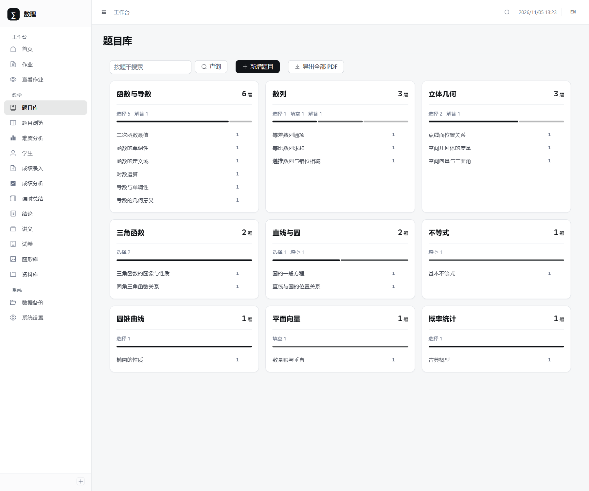
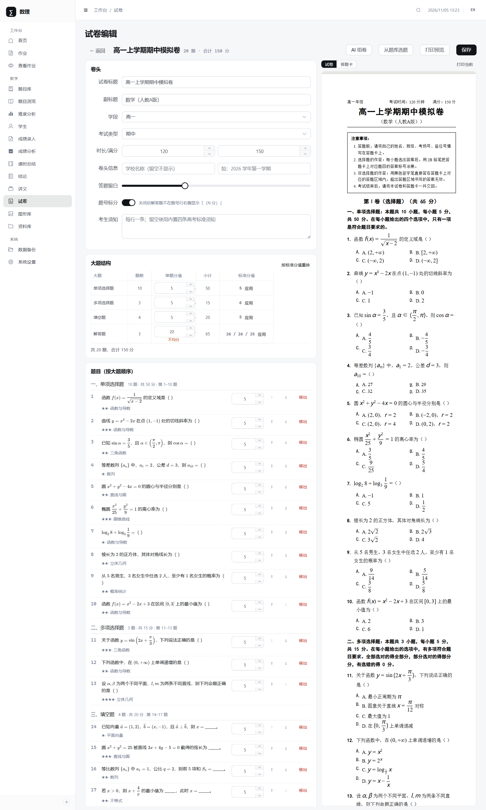
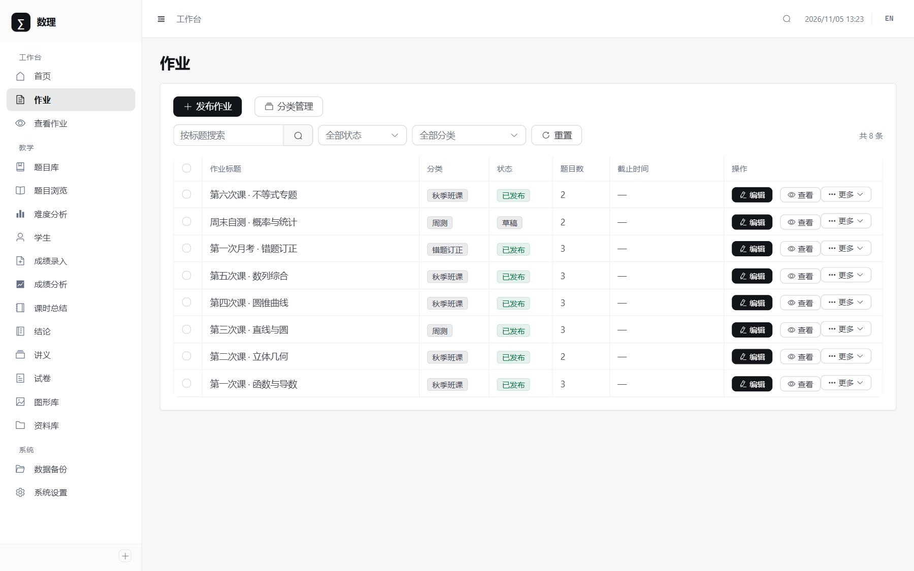
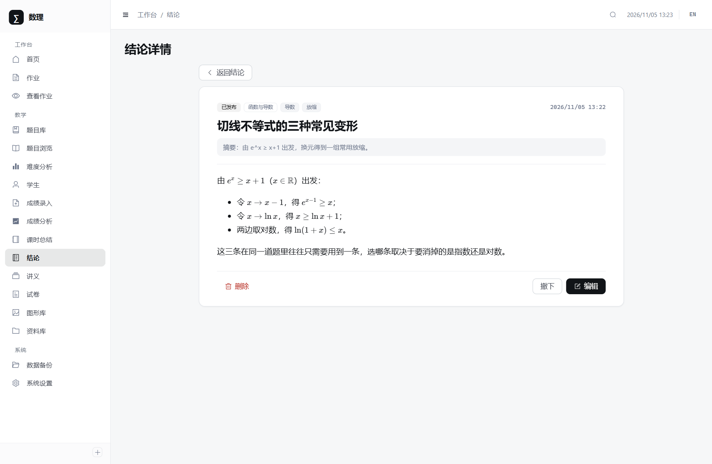
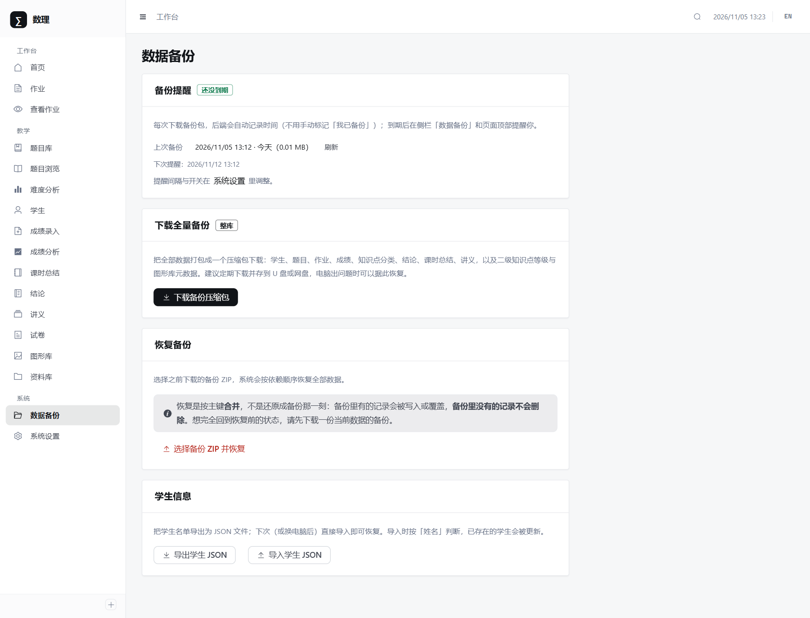

# Shuli · 数理

**面向一线教师的试题与试卷工作台。** 题库、组卷、作业、成绩、讲义共用一套数据模型——
同一道题在试卷里排成卷子、在作业里派给学生、在讲义里连成知识点，改一次题干，三处同步。

自托管、单用户、无登录，数据留在本机。

[](https://github.com/eat-li/shuli/actions/workflows/ci.yml)
[](LICENSE)


## 为什么会有这个东西

教书的人都有一套自己的「题库」，通常是：一堆 Word 文档、微信里发给自己的图片、几本翻旧了的教辅、
以及若干份改过七八版的单元卷。需要出卷子的时候，把它们翻出来，复制、粘贴、调格式、算分值、拼答题卡，
两个小时就过去了——而这件事每学期要做十几次。

更麻烦的是同一道题有好几份副本：卷子里一份、作业里一份、讲义里再抄一遍。后来发现题干有个笔误，
三处都得改，改完还得确认三处真的改成一样了。

这个项目的出发点很朴素：**一道题只存一份，其余都是引用**。

## 一条数据，四个出口

同一个 `question` 记录，可以被不同模块以不同形式引用：

| 出口 | 它变成什么 | 引用保存在哪 |
| --- | --- | --- |
| 试卷 | A4 排版、按大题分区、带分值与答题卡 | `paper_questions`（分区 + 序号 + 分值） |
| 作业 | 派给指定学生、可导出 PDF、可录入成绩 | `homework_questions` / `homework_students` |
| 讲义 | 与结论、知识点一起编成文档 | `handout.content`（文档式正文） |
| 知识点页 | 按一级/二级知识点聚合，看某一类题练得够不够 | `question.knowledgeTag` |

改题干只改 `question` 一行，四个出口同时生效。删除会拦住——被引用过的题不能裸删，
避免留下指向空记录的行。

## 功能

### 题库

按知识点组织，而不是按录入顺序。一级知识点下挂二级知识点，卡片上直接显示「几道选择、几道解答」，
点进去就是这个知识点的全部题目。题目支持富文本 + LaTeX（行内 `$...$`）、图片、选项与解析分离。

### 组卷

按「单项选择 / 多项选择 / 填空 / 解答」四个大题编排，每大题可设题数与单题分值，
右侧实时渲染 A4 试卷与答题卡。题号、分值小计、卷面总分自动算，答案默认不跟随题目显示。
也可以让 AI 按学段和难度自动选题，选完仍可手工调整。

### 作业

同样是选题 + 派发，但多了「给谁」这一层：按学生名单发布，可导出 PDF，可逐人录入成绩。
作业按分类归档，「未分类」是一个真实存在的桶，不是空值兜底。

### 成绩

手工录入或 CSV 批量导入，按考试类型（期末/期中/月考/模拟考/小测/随堂测验，可自行增删）归档。
分析页给出平均分对比、分数段分布、单人趋势与学科雷达——都按百分比折算，满分不同的考试可以放在一起看。

### 结论

「二级结论」是数学教学里很实用的一类东西：切线不等式、弦长公式、二面角建系套路。
写成卡片、分类归档、可发布，之后在讲义里直接引用，不用每次重新推导一遍。

### 讲义

题目 + 结论 + 知识点拼装成文档。文档式编辑（不是表单），可插入题目、公式、表格、图片与流程图，
排版完直接导出 PDF 发给学生。

### 资产与备份

资料库按多级目录归档文件，图形库用瀑布流管理几何图形素材（文件本体可放本地磁盘或阿里云 OSS）。
数据备份把全部业务表打成一个 ZIP，恢复时按依赖顺序写回，孤儿关联会被跳过并如实报告。

## 界面

> 以下截图来自演示数据，非真实教学记录。

### 题库：先看知识点分布，再看具体题目



### 组卷：左边编辑，右边就是印出来的样子



### 难度分析：题库是不是「头重脚轻」，一眼能看出来


### 成绩分析：分数段与趋势


### 作业：发布、选题、派发



### 结论：可复用的二级结论卡片



### 备份：一份 ZIP 就是全部数据



## 快速开始

### 给使用者：解压就能用

到 [Releases](https://github.com/eat-li/shuli/releases/latest) 下载 `shuli-<版本>-win64.zip`，
解压到任意目录，双击 **`start.bat`**。
浏览器会自动打开，没有安装步骤，不需要 Node、pnpm，也不需要装数据库。

- 数据在 `server\data\`：`shuli.sqlite` 是全部业务数据，`uploads\` 是上传的图片。
  把整个 `data` 目录复制走就是一份完整备份（更推荐用界面里的「设置 → 备份」导 ZIP）。
- 想开机自启：双击 `autostart-install.bat`。
- 停止服务：双击 `stop.bat`，或直接关掉那个黑窗口。

> **没有登录**，所以默认只监听 `127.0.0.1`，只有这台电脑能访问。
> 改成 `HOST=0.0.0.0` 前，请确认你能控制谁能连到这台机器。

### 给开发者：源码运行

环境：Node 18+、pnpm。

```bash
pnpm install
pnpm dev          # 前端 5173，后端 7788
```

首次启动会自动在 `server/data/shuli.sqlite` 建库建表，不需要任何手工初始化。
日常使用（后端直接托管构建产物，只跑一个进程）：

```bash
pnpm build
pnpm start
```

出便携包（生成 `release/`，内置 node.exe 与生产依赖，可直接发给别人）：

```bash
pnpm pack:release
```

> 不要用 `pnpm pack`——那是 pnpm 自带命令，会把这个仓库打成一个 npm 安装包（`shuli-*.tgz`），
> 不是给老师用的便携包。

> `*.bat` 一律只写 ASCII。cmd 解析批处理用的是它启动那一刻的控制台代码页，
> 脚本里再 `chcp` 也救不回来——夹带中文会把换行吃掉，整份脚本从那里开始报错。
> 面向用户的提示语都放在 Node 里输出（详见 `.gitattributes` 的说明）。

## 配置

**默认不需要任何配置。** 数据库是本地 SQLite 文件，端口 7788，图片落本地磁盘——
`server/.env` 不存在也能正常跑。只有要改端口、开局域网访问、接 OSS 或统一托管 AI Key 时，
才把它从 [`server/.env.example`](server/.env.example) 复制出来，只写要改的那几行。

| 分组 | 关键变量 | 说明 |
| --- | --- | --- |
| 服务 | `PORT`、`HOST` | 默认 `7788` / `127.0.0.1` |
| 数据库 | `DB_FILE` | 默认 `server/data/shuli.sqlite`，一般不用改 |
| 文件存储 | `STORAGE_DRIVER`、`STORAGE_LOCAL_DIR` | 默认本地磁盘，见下节 |
| AI（可选） | 一般在界面「设置 → AI」里填 | 不配时 AI 功能不可用，其余功能不受影响 |

端口改动的连锁点只有一处：`server/.env`。启动脚本、停止脚本、Vite 代理都从那里读。

## 文件存储

默认落本地磁盘，可切阿里云 OSS。两种驱动接口一致，切换只改环境变量。

| 驱动 | 文件位置 | 对外 URL | 缩略图 |
| --- | --- | --- | --- |
| `local`（默认） | `server/data/uploads/` | `/uploads/<key>` 相对路径 | 原图 |
| `oss` | 你的 bucket | OSS 域名 | 缩放后的 WebP |

```env
STORAGE_DRIVER=local
STORAGE_LOCAL_DIR=data/uploads      # 相对路径以 server/ 为基准
STORAGE_PUBLIC_BASE_URL=            # 留空即用相对路径；挂 CDN 时才填
```

三点要注意：

- **URL 是相对路径，不写死域名**。写死域名后换个网络环境就整站裂图，而这种错误在开发机上永远复现不出来。
- **切换驱动不会让老图失效**。库里存的是完整 URL，浏览器直接去取；删除时按 URL 判定归属，不属于当前驱动就只删记录，响应里标 `ossSkipped`。
- **驱动在启动时决定**，不支持热切换——否则每次读图都要试两边才知道文件在哪。换存储 = 按同样的 key 搬完文件，再改 `STORAGE_DRIVER` 重启。

## 数据

- **数据库**：SQLite 单文件，WAL 模式（读写互不阻塞）。整个库就是一个文件，
  拷走即备份；单进程使用，无需考虑连接池与并发 DDL。
- **建表**：启动时按模型比对表名，缺表才建，表齐全直接跳过（正常启动约 150ms）。
- **迁移**：已存在的库要加字段时，在 `server/migrations` 新增迁移文件，启动时自动执行并记入
  `migrations` 表；执行成功才写记录，失败下次重跑。规矩见 [`server/migrations/README.md`](server/migrations/README.md)。
- **备份**：设置页可导出全量 ZIP，也可导入恢复。备份是逻辑格式（一堆 JSON），与数据库方言无关；
  恢复按主键 upsert，不会删除备份里没有的数据。外键指向的父数据不存在时：父记录可为空的列置空保留整行（如作业的分类），
  其余跳过并在结果里报告条数。

### 从 MySQL 版本升级

v0.1 及更早的版本用 MySQL。v1.0 换成 SQLite 后**不支持原地升级**，路径是：

1. 在旧版本里「设置 → 备份」导出 ZIP；
2. 装好新版本，进「设置 → 备份」导入同一个 ZIP。

备份是逻辑格式，跨方言可用，题目里的图片也包含在 ZIP 里。

## 常用命令

| 命令 | 作用 |
| --- | --- |
| `pnpm dev` | 同时启动前后端（前端 5173，代理 `/api` 到 7788） |
| `pnpm build` | 构建前端到 `client/dist` |
| `pnpm start` | 只跑后端，同时托管 `client/dist`（日常使用） |
| `pnpm pack:release` | 生成便携包 `release/` |
| `pnpm lint` | ESLint 检查 |
| `pnpm test` | 服务端测试（每个用例开自己的临时 SQLite 库，不需要任何外部服务） |
| `pnpm --filter ./client i18n:check` | 校验中英文案键树一致 |

## 技术栈

| 层 | 选型 |
| --- | --- |
| 前端 | Vue 3 + TypeScript + Vite，Element Plus 组件，ECharts 图表 |
| 富文本 | Tiptap（题干、解析、讲义正文），KaTeX 渲染公式，Mermaid 画图 |
| 后端 | Express 5 + Sequelize 6，SQLite（WAL），multer 上传 |
| 打包 | 后端直接托管前端构建产物，单进程；便携包内置 node.exe |

## 目录结构

```text
.
├── client/src/            # 前端：api / components / composables / i18n / layouts
│                          #       plugins / router / styles / types / utils / views
├── docs/screenshots/      # README 用的界面截图
├── scripts/
│   └── pack-release.mjs   # 出便携包
├── server/
│   ├── migrations/        # 增量迁移（平时为空，改表时新增）
│   ├── src/               # config / controllers / middlewares / models
│   │                      # routes / services / storage / utils
│   └── test/              # 纯函数测试 + 接口测试（临时库，跑完删文件）
```

## 安全须知

- **本版本没有鉴权**：能访问端口的人就能读写全部数据。仅建议在本机使用；需要局域网/公网访问时，请在前面加反向代理并自行配置访问控制。
- AI 接口地址默认走白名单（`AI_ALLOWED_BASE_URLS`），避免后端被当作任意请求代理（SSRF）。
- 上传按扩展名白名单校验；写入响应头的文件名会先剥掉控制字符。

## 状态与路线

v1.0：默认库换成 SQLite，开箱即用——不装数据库、不写配置、不装 Node（便携包）。
测试不再依赖任何外部服务，`pnpm test` 在任何机器上都能跑完整套。

下一步：补齐英文文案，补一份「从零录一套卷子」的完整教程。

界面支持中英双语，英文覆盖尚不完整。

## 许可证

[MIT](LICENSE)
